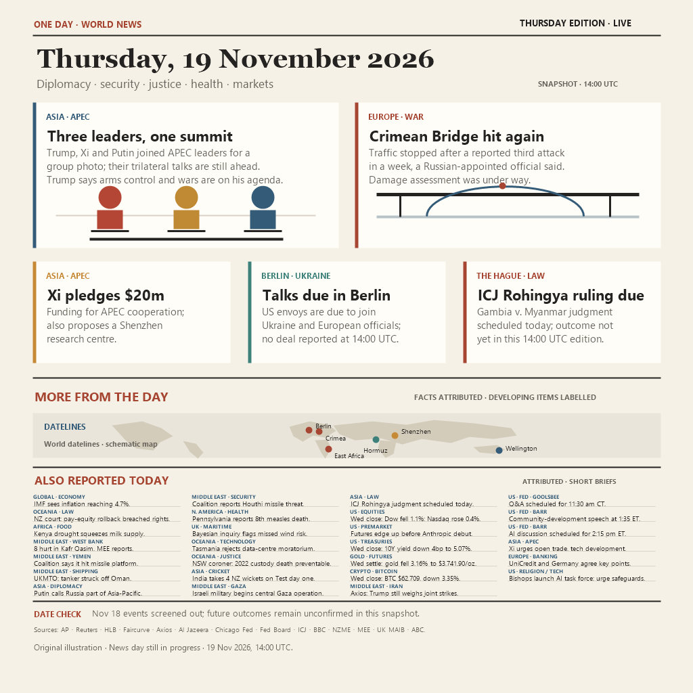



# 19 November 2026 — World News in One Image

An original one-page editorial image with 32 same-day news items. Snapshot: 14:00 UTC on 19 November 2026.

Market figures are labelled as Wednesday 18 November closes/settles. The Federal Reserve appearances shown were scheduled for later on 19 November, not reported as delivered.

See [SOURCES.md](SOURCES.md) for the source and date ledger. The artwork uses original illustrations and a schematic map.

## Run

With Node.js, set `MAKEFUN_OUTPUT_DIR` to a writable directory and run `node main.ts`. The program validates and copies `entry.png`.
